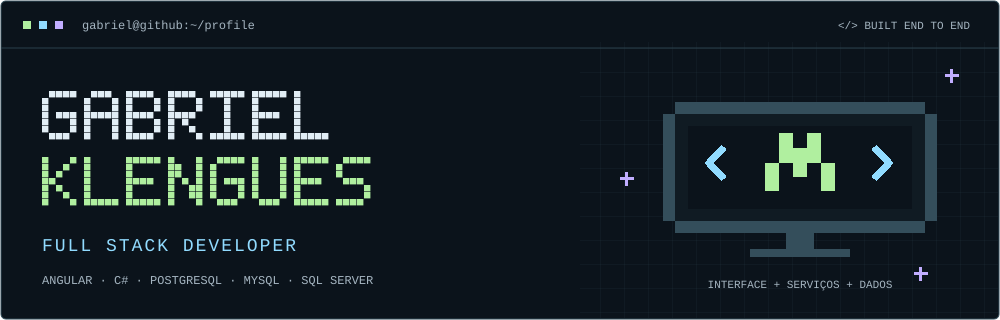
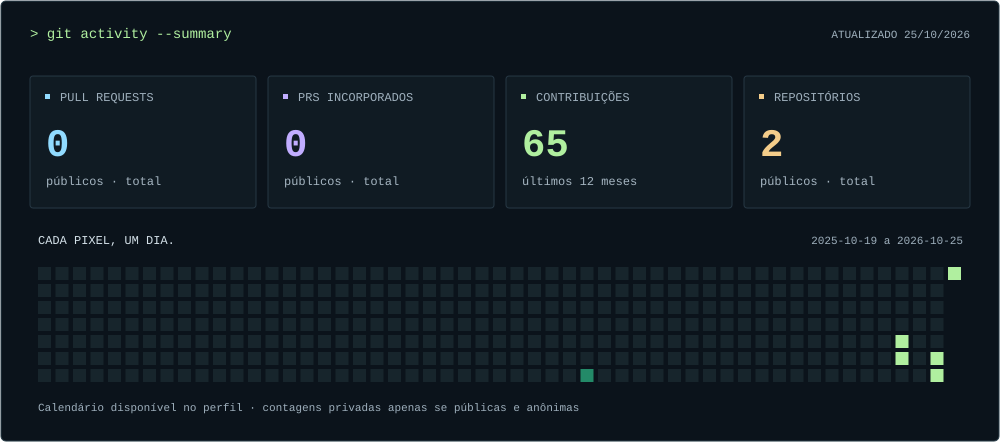

<p align="center">
  
</p>

<p align="center">
  <a href="https://www.linkedin.com/in/gabriel-klengues/">LinkedIn</a> &nbsp;·&nbsp;
  <a href="mailto:gabrielklengues.dev@gmail.com">E-mail</a> &nbsp;·&nbsp;
  <a href="https://github.com/gabrielklengues?tab=repositories">Repositórios</a> &nbsp;·&nbsp;
  <a href="https://github.com/search?q=author%3Agabrielklengues+is%3Apr+is%3Apublic&amp;type=pullrequests">Pull requests</a>
</p>

```text
+-----------------------------------------------------+
| gabriel@github:~$ whoami                            |
|                                                     |
| Full Stack Developer                                |
| Frontend  > Angular                                 |
| Backend   > C#                                      |
| Database  > PostgreSQL / MySQL / SQL Server         |
+-----------------------------------------------------+
```

### 01 / Sobre mim

Sou **Gabriel Klengues**, desenvolvedor **Full Stack**, com atuação no frontend, backend e banco de dados. Construo produtos de ponta a ponta, conectando interfaces, serviços e dados.

Meu foco está em **Angular**, **C#** e **bancos relacionais**, com atenção à experiência de uso, desempenho e integrações.

### 02 / Stack principal

| Camada | Tecnologias |
| :--- | :--- |
| **Frontend** | `Angular` |
| **Backend** | `C#` |
| **Banco de dados** | `PostgreSQL` · `MySQL` · `SQL Server` |

### 03 / Formação

**Análise e Desenvolvimento de Sistemas** — graduação concluída.

### 04 / Atividade no GitHub

<a href="https://github.com/gabrielklengues?tab=overview">
  
</a>

<sub>PRs e repositórios: totais públicos. Contribuições: calendário dos últimos 12 meses disponibilizado pelo GitHub; pode incluir contagens privadas anônimas se estiverem visíveis no perfil. Atualização diária.</sub>

---

```text
> Interface + serviços + dados.
> Vamos construir algo juntos? Entre em contato.
```
