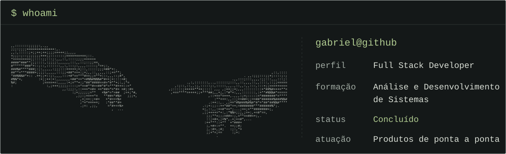
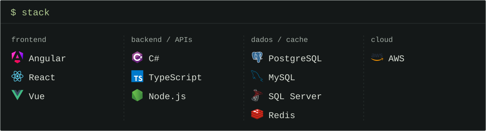
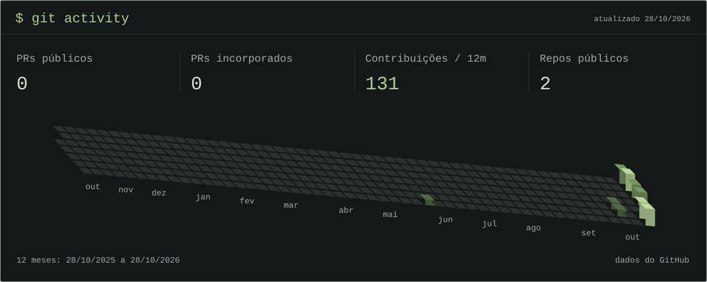

  <picture>
    <source media="(max-width: 760px)" srcset="./assets/whoami-mobile.svg" />
    
  </picture>

  <picture>
    <source media="(max-width: 760px)" srcset="./assets/stack-mobile.svg" />
    
  </picture>

  <picture>
    <source media="(max-width: 760px)" srcset="./assets/activity-isometric-mobile.svg" />
    
  </picture>

PRs e repositórios: totais públicos. O calendário pode incluir contagens privadas anônimas já visíveis no perfil. Atualização diária.
